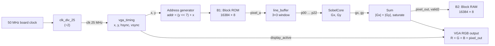
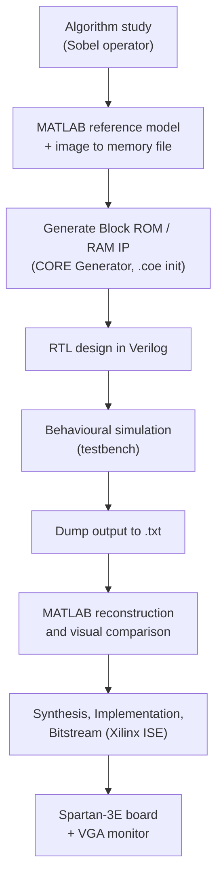
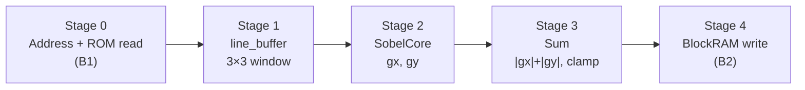
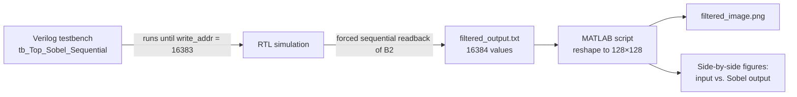

# Real-Time Sobel Edge Detection on FPGA (Spartan-3E)


A fully pipelined, hardware implementation of the **Sobel edge detection** algorithm written in Verilog and targeted at a **Xilinx Spartan-3E** FPGA. A 128×128, 8-bit grayscale image is stored in on-chip Block ROM, streamed through a line-buffer based 3×3 convolution engine, and the edge-magnitude result is written to Block RAM and driven to a **640×480 @ 60 Hz VGA** timing generator.

<p align="center">
  
  &nbsp;&nbsp;➜&nbsp;&nbsp;
  
</p>
<p align="center"><i>Left: 128×128 grayscale input. Right: Sobel edge-detected output produced by the RTL simulation.</i></p>

---

## Table of Contents

1. [Overview](#1-overview)
2. [Project Highlights](#2-project-highlights)
3. [System Architecture](#3-system-architecture)
4. [Design Flow](#4-design-flow)
5. [FPGA Memory Architecture (Block RAM)](#5-fpga-memory-architecture-block-ram)
6. [RTL Modules](#6-rtl-modules)
7. [Convolution Engine and Sobel Kernels](#7-convolution-engine-and-sobel-kernels)
8. [Processing Steps](#8-processing-steps)
9. [VGA Display System](#9-vga-display-system)
10. [Streaming Pipeline Architecture](#10-streaming-pipeline-architecture)
11. [Verification and Results](#11-verification-and-results)
12. [FPGA Design Considerations](#12-fpga-design-considerations)
13. [Future Improvements](#13-future-improvements)
14. [Tools and Technologies](#14-tools-and-technologies)
15. [Repository Structure](#15-repository-structure)
16. [How to Run](#16-how-to-run)
17. [Author](#17-author)

---

## 1. Overview

Edge detection is a core building block of computer vision: it highlights intensity discontinuities and reduces an image to its structural outline. The Sobel operator approximates the image gradient using two 3×3 convolution kernels, one for horizontal changes and one for vertical changes.

Software implementations process pixels sequentially on a CPU. This project moves the computation into hardware so that **one pixel enters and one result leaves per clock cycle**, with the convolution done by dedicated adders and shifters instead of general-purpose multipliers.

| Parameter | Value |
|---|---|
| Target FPGA | Xilinx Spartan-3E |
| HDL | Verilog |
| Image size | 128 × 128 pixels |
| Pixel depth | 8-bit grayscale |
| Operator | Sobel 3×3 (Gx, Gy) |
| Magnitude | \|Gx\| + \|Gy\| (saturated to 255) |
| Pixel clock | 25 MHz (divided from the 50 MHz board clock) |
| Output | 640×480 @ 60 Hz VGA timing, 128×128 image window |
| Throughput | 1 pixel / clock cycle |

---

## 2. Project Highlights

- Fully synchronous, **streaming architecture**: one pixel per clock after pipeline fill.
- **Multiplier-free convolution**: the ×2 Sobel weights are implemented as left shifts.
- **Two-line buffer** that builds a 3×3 sliding window on the fly, so the image is read from memory only once.
- **Block RAM based** storage for both the source image (Block ROM `B1`) and the filtered result (Block RAM `B2`).
- Integrated **VGA timing generator** (640×480 @ 60 Hz) with a restricted 128×128 processing window.
- **Hardware/software co-verification**: RTL testbench dumps the result to a text file, and a MATLAB script rebuilds and compares the image.
- Clean modular RTL: each stage (clock divider, VGA timing, line buffer, kernel, magnitude, memory) is a separate, reusable module.

---

## 3. System Architecture



**Top-level module:** `Top_Sobel`

| Port | Dir | Width | Description |
|---|---|---|---|
| `clk_50` | in | 1 | 50 MHz board clock |
| `reset` | in | 1 | Asynchronous active-high reset |
| `pixel` | out | 8 | Edge-detected pixel (debug / probe) |
| `hsync`, `vsync` | out | 1 | VGA sync signals (active low) |
| `vga_r`, `vga_g`, `vga_b` | out | 8 | Grayscale pixel replicated on all channels |

---

## 4. Design Flow



1. **Algorithm study.** Sobel kernels, gradient magnitude approximation, and bit-width analysis.
2. **Reference model.** The source image is converted to 128×128 grayscale and exported as a memory initialisation file.
3. **IP generation.** Block ROM (`B1`) is initialised with the image; Block RAM (`B2`) is created to hold the result.
4. **RTL design and simulation.** Each module is written and verified, then integrated in `Top_Sobel`.
5. **Result extraction.** The testbench writes every output pixel to `filtered_output.txt`.
6. **MATLAB verification.** The text file is reshaped to 128×128 and saved as `filtered_image.png` for visual comparison with the input.
7. **Implementation.** Synthesis, place and route, and bitstream generation for Spartan-3E in Xilinx ISE.

---

## 5. FPGA Memory Architecture (Block RAM)

The Spartan-3E provides dedicated 18 Kbit Block RAM primitives. The design uses two memories sized for the 128×128 image (16,384 locations × 8 bits = 128 Kbit):

| Instance | Type | Depth × Width | Address | Role |
|---|---|---|---|---|
| `B1` | Single-port Block ROM (write disabled: `wea = 0`) | 16384 × 8 | `(y << 7) + x` (14-bit) | Holds the source image, initialised from a `.coe` file |
| `B2` | Single-port Block RAM | 16384 × 8 | `write_addr` (14-bit sequential counter) | Stores the Sobel result, one write per valid output pixel |

```
        Image address (14-bit)
 y[6:0] , x[6:0]  ->  addr = y*128 + x
 ┌───────────────┬───────────────┐
 │   y [13:7]    │    x [6:0]    │
 └───────────────┴───────────────┘
```

**Why a sequential write counter for `B2`?**
The Sobel pipeline introduces several cycles of latency, so the output pixel at time *t* no longer corresponds to the current VGA (x, y). Writing with a free-running counter that increments only when `valid2` is high keeps the stored image in correct raster order regardless of pipeline depth.

**Line buffers.** The two 128-entry line buffers inside `line_buffer.v` (2 × 128 × 8 bit) hold the previous two image rows so that three rows are available simultaneously for the 3×3 window.

> The exact number of Block RAMs consumed depends on the device selected. Fill in the actual figures from your synthesis report in the [utilisation table](#12-fpga-design-considerations).

---

## 6. RTL Modules

| Module | File | Function |
|---|---|---|
| `Top_Sobel` | `Top_Sobel.v` | Top-level integration of clocking, memory, processing and VGA output |
| `clk_div_25` | `clk_div_25.v` | Divides the 50 MHz clock by 2 to produce the 25 MHz VGA pixel clock |
| `vga_timing` | `vga_timing.v` | Generates `h_count`/`v_count`, pixel coordinates `x`/`y`, `hsync`, `vsync`, `display_active` |
| `B1` (Block ROM) | `ipcore_dir/B1` | Source image storage (CORE Generator IP) |
| `line_buffer` | `line_buffer.v` | Two row buffers and the 3×3 sliding window registers `p00 … p22` |
| `SobelCore` | `SobelCore.v` | Computes the signed horizontal and vertical gradients `gx`, `gy` |
| `Sum` | `Sum.v` | Absolute value, addition, saturation to 8 bits, and output-valid generation |
| `BlockRAM` (`B2`) | `ipcore_dir/BlockRAM` | Result image storage (CORE Generator IP) |
| `Count` | `Count.v` | Standalone 128×128 X/Y raster counter (utility module, wraps at 127) |
| `tb_Top_Sobel_Sequential` | `tb_Top_Sobel.v` | Self-running testbench and memory dump |

### Module interfaces

**`line_buffer`**: `clk, reset, valid, pixel_in[7:0]` → `p00 … p22` (nine 8-bit window pixels)

**`SobelCore`**: `clk, reset, valid, w00 … w22` → `gx[11:0]`, `gy[11:0]` (signed)

**`Sum`**: `clk, reset, valid, gx[11:0], gy[11:0]` → `edge_out[7:0]`, `out_valid`

---

## 7. Convolution Engine and Sobel Kernels

The Sobel operator convolves the 3×3 pixel neighbourhood with two kernels:

```
        Gx (horizontal gradient)            Gy (vertical gradient)
        ┌────┬────┬────┐                    ┌────┬────┬────┐
        │ -1 │  0 │ +1 │                    │ -1 │ -2 │ -1 │
        ├────┼────┼────┤                    ├────┼────┼────┤
        │ -2 │  0 │ +2 │                    │  0 │  0 │  0 │
        ├────┼────┼────┤                    ├────┼────┼────┤
        │ -1 │  0 │ +1 │                    │ +1 │ +2 │ +1 │
        └────┴────┴────┘                    └────┴────┴────┘
```

The 3×3 window is named as follows (row, column):

```
        w00  w01  w02
        w10  w11  w12
        w20  w21  w22
```

### Hardware equations (from `SobelCore.v`)

```verilog
gx <= (w02 + (w12 << 1) + w22) - (w00 + (w10 << 1) + w20);
gy <= (w20 + (w21 << 1) + w22) - (w00 + (w01 << 1) + w02);
```

- Multiplication by 2 is a **1-bit left shift**, so no hardware multipliers are used.
- Each gradient is a sum and difference of 8-bit values. The worst-case magnitude is 4 × 255 = 1020, which fits a **12-bit signed** register.

### Gradient magnitude (from `Sum.v`)

The exact magnitude √(Gx² + Gy²) needs a multiplier and a square root. The classic hardware-friendly approximation is used instead:

```
|G| ≈ |Gx| + |Gy|          → clamp to 255 → 8-bit edge pixel
```

---

## 8. Processing Steps

1. **Reset and clock generation.** `clk_div_25` creates the 25 MHz clock used by the entire design.
2. **Coordinate generation.** `vga_timing` produces pixel coordinates `x`, `y` and the `display_active` flag.
3. **Processing window.** `process_active = display_active && (x < 128) && (y < 128)` restricts processing to the 128×128 image area.
4. **Pixel fetch.** The address `(y << 7) + x` reads one pixel from Block ROM `B1`.
5. **Window formation.** `line_buffer` shifts the pixel through two row buffers and exposes nine registers `p00 … p22`.
6. **Gradient computation.** `SobelCore` computes `gx` and `gy` using shifts and adders.
7. **Magnitude and saturation.** `Sum` takes absolute values, adds them, saturates at 255 and raises `out_valid`.
8. **Storage.** When `valid2` is high, the pixel is written to Block RAM `B2` at the sequential `write_addr`, which then increments.
9. **Display.** The edge pixel drives `vga_r/g/b` inside the image window and black everywhere else.

---

## 9. VGA Display System

`vga_timing` implements the standard **640×480 @ 60 Hz** mode with a 25 MHz pixel clock.

| | Visible | Front porch | Sync pulse | Back porch | Total |
|---|---|---|---|---|---|
| **Horizontal (pixels)** | 640 | 16 | 96 | 48 | **800** |
| **Vertical (lines)** | 480 | 10 | 2 | 33 | **525** |

- `hsync` and `vsync` are **active low**.
- `x` and `y` are generated combinationally from the counters so that the ROM address is available in the same cycle, with no extra register delay.
- The 128×128 filtered image is shown in the top-left corner of the screen; the rest of the visible area is driven black.
- The 8-bit edge value is replicated on the red, green and blue outputs to produce a grayscale picture.

Frame rate: 25 MHz / (800 × 525) ≈ **59.5 Hz**.

---

## 10. Streaming Pipeline Architecture



| Stage | Registered output | Operation |
|---|---|---|
| ROM read | `pixel_a` | Synchronous Block ROM read (1 cycle) |
| Window | `p00 … p22` | Row buffers and 3×3 window registers |
| Gradient | `gx`, `gy` | Two parallel convolutions |
| Magnitude | `edge_out`, `out_valid` | Absolute value, add, saturate |
| Store | `B2` | Write with sequential address |

- Every stage is registered, so the design sustains **one pixel per clock**.
- `Gx` and `Gy` are computed **in parallel**.
- The `out_valid` flag travels with the data and gates the write enable of `B2`, so only valid results are stored.
- One full image occupies 128 active lines × 800 clocks per line, which is roughly **4.1 ms** at 25 MHz.

---

## 11. Verification and Results

### Verification flow



1. The testbench generates a 50 MHz clock, applies reset for 100 ns, then waits until the last pixel address (`16383`) has been written.
2. Writing is then disabled and the testbench steps through all 16,384 locations of `B2`, waiting two clocks per address to cover the Block RAM read latency.
3. Each pixel value is written as a decimal number on its own line in `filtered_output.txt`.
4. MATLAB reads the file, reshapes it to 128×128, saves `filtered_image.png`, and displays the input and output side by side.

### Results

<p align="center">
  
</p>

- The output clearly shows the outline of the cat, the question mark, and the rounded border of the input.
- Flat regions map to black (zero gradient); strong intensity transitions map to white.
- The MATLAB script reports successful reconstruction and saves `filtered_image.png`.

### Verification summary

| Check | Method | Status |
|---|---|---|
| Clock division (50 → 25 MHz) | Waveform inspection | ✅ |
| VGA timing (800 × 525 totals, sync polarity) | Waveform inspection | ✅ |
| Sobel arithmetic and saturation | Visual comparison with expected edge map | ✅ |
| Full-frame output (16384 pixels) | `filtered_output.txt` → MATLAB reconstruction | ✅ |
| On-board VGA display | Spartan-3E board and monitor | *(fill in if tested)* |

> **Tip:** add a simulation waveform screenshot to `docs/images/waveform.png` and, if you have one, a numeric comparison (for example, mean absolute difference against MATLAB's `edge(img,'sobel')` or a custom reference model).

---

## 12. FPGA Design Considerations

- **Fixed-point bit widths.** 8-bit pixels → 12-bit signed gradients (range ±1020) → 13-bit sum → saturated 8-bit result. No overflow can occur.
- **No DSP/multiplier blocks.** All weights are powers of two, so shifts and adders are sufficient. This keeps the design portable to devices without hardware multipliers.
- **Memory choice.** Both image buffers use Block RAM, leaving fabric LUTs free for logic. The Spartan-3E Block RAM is synchronous, so each read has one clock of latency.
- **Line buffer implementation.** The 128-entry row buffers use an array reset loop, which usually maps to registers/distributed memory instead of Block RAM. A dedicated dual-port Block RAM or shift-register (SRL16) implementation would reduce slice usage.
- **Border handling.** The first rows/columns of the image lack a complete 3×3 neighbourhood. The window uses zero padding (`col > 0 ? … : 0`), so the outermost edges of the output may show border artefacts.
- **Clocking.** A simple toggle divider generates the 25 MHz clock. On real hardware a DCM or a clock-enable scheme is preferable because it keeps the whole design on the global clock network.
- **Reset strategy.** Asynchronous active-high reset is used for all registers.
- **Timing.** At 25 MHz the design has large slack on Spartan-3E; the critical path is the three-term sum/difference in `SobelCore`.

### Resource utilisation *(fill in from your ISE synthesis report)*

| Resource | Used | Available | Utilisation |
|---|---|---|---|
| Slices | – | – | – |
| Slice Flip-Flops | – | – | – |
| 4-input LUTs | – | – | – |
| Block RAM (18 Kb) | – | – | – |
| Max frequency | – MHz | | |

**Target device:** `XC3S___E-____` *(for example, on a Spartan-3E Starter Kit)*

---

## 13. Future Improvements

- **Correct latency alignment.** Delay the `valid` signals through the pipeline stages so that each stage is enabled by the previous stage's valid flag, and account for the one-cycle Block ROM read latency.
- **Proper border handling.** Replicate or mirror edge pixels instead of zero padding, and mask output for the first two rows/columns.
- **Streamed window shift registers.** Build the window from true pixel history (`pixel_in` delayed by one and two cycles) and use dual-port Block RAM for the row buffers.
- **Configurable threshold.** Add a binary threshold stage (switch-controlled) to produce a clean black/white edge map.
- **Selectable filters.** Add Prewitt, Laplacian, Gaussian blur and sharpening kernels with a mux in the convolution engine.
- **Gaussian pre-filter + non-maximum suppression** to move towards a Canny edge detector.
- **Live camera input.** Replace the ROM with a camera interface (for example an OV7670 over a pixel stream) for real-time video.
- **Larger resolutions.** Parameterise image width/height and use external SRAM/SDRAM for frames larger than the on-chip Block RAM.
- **Migration to newer devices.** Port to Artix-7 / Vivado, which also allows using DSP slices and the integrated logic analyser (ILA).
- **Automated checking.** Add a self-checking testbench that compares against a golden model and reports pass/fail.
- **Performance metrics.** Report fmax, power estimates and an equivalent software (CPU/MATLAB) timing comparison.

---

## 14. Tools and Technologies

| Category | Tool / Technology |
|---|---|
| HDL | Verilog |
| FPGA family | Xilinx Spartan-3E |
| Synthesis and implementation | Xilinx ISE Design Suite *(add version)* |
| IP generation | Xilinx CORE Generator (Block ROM / Block RAM) |
| Simulation | ISim / Verilog testbench *(adjust if you used another simulator)* |
| Verification and image reconstruction | MATLAB |
| Algorithm | Sobel operator, gradient magnitude approximation |
| Interface | VGA (640×480 @ 60 Hz) |
| Version control | Git and GitHub |

---

## 15. Repository Structure

```
fpga-sobel-edge-detection/
├── src/
│   ├── Top_Sobel.v
│   ├── clk_div_25.v
│   ├── vga_timing.v
│   ├── line_buffer.v
│   ├── SobelCore.v
│   ├── Sum.v
│   └── Count.v
├── ip/
│   ├── B1.xco              # Block ROM (CORE Generator project file)
│   ├── BlockRAM.xco        # Block RAM (CORE Generator project file)
│   └── image.coe           # ROM initialisation data
├── sim/
│   └── tb_Top_Sobel.v
├── matlab/
│   └── reconstruct_image.m # reads filtered_output.txt, saves filtered_image.png
├── constraints/
│   └── Top_Sobel.ucf       # pin constraints (Spartan-3E board)
├── docs/
│   └── images/
│       ├── input_image.png
│       ├── sobel_output.png
│       └── matlab_results.png
├── .gitignore
├── LICENSE
└── README.md
```

---

## 16. How to Run

### Simulation

1. Open the project in Xilinx ISE (or create a new project and add `src/`, `ip/` and `sim/` files).
2. Regenerate the Block ROM `B1` (using `image.coe`) and Block RAM `B2` with CORE Generator.
3. Set `tb_Top_Sobel_Sequential` as the simulation top module and run behavioural simulation.
4. Wait for the console message `Dump complete!`. The file `filtered_output.txt` is created in the simulation directory.
5. Run the MATLAB script in `matlab/` to reconstruct and view `filtered_image.png`.

### Hardware

1. Assign pins in `constraints/Top_Sobel.ucf` for `clk_50`, `reset`, `hsync`, `vsync` and the VGA colour lines of your board.
2. Synthesise, implement and generate the programming file.
3. Program the Spartan-3E board and connect a VGA monitor. The Sobel-filtered image appears in the top-left 128×128 region.

---

## 17. Author

**Umair**
Computer Engineering, COMSATS University Islamabad

- GitHub: [@your-username](https://github.com/your-username)
- LinkedIn: *your-link*

---

## License

This project is released under the MIT License. See [`LICENSE`](LICENSE) for details.

> If you found this project useful, consider giving it a ⭐ on GitHub.
